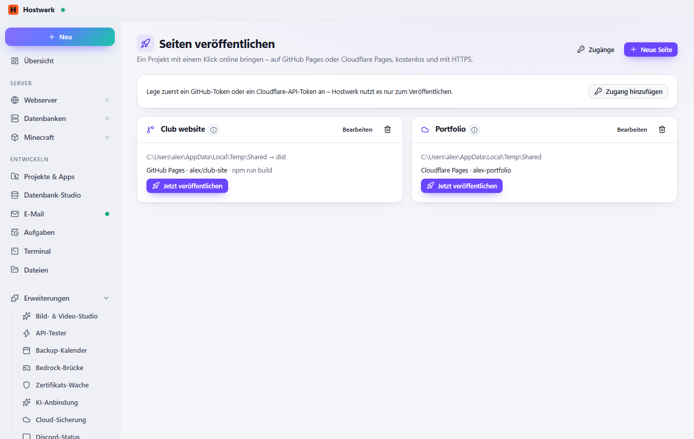

# Seiten veröffentlichen

Ein Projekt mit einem Klick online bringen – auf GitHub Pages oder Cloudflare Pages, kostenlos und mit HTTPS. Mit Build-Befehl (z. B. npm run build), Prüfung des Ordners und Verlauf je Seite.

[English](README.md) · Offizielle [Hostwerk](https://github.com/Passimoritz/hostwerk-public)-Erweiterung (native Erweiterung, ab Hostwerk 2.10)



## Was sie kann

- **Wo:** Projekte → Veröffentlichen – seit 1.3.0 ohne eigenen Seitenleisten-Eintrag; die ganze Seite bleibt unter Erweiterungen → Öffnen
- GitHub Pages ohne lokales git: Hochladen über GitHubs Schnittstelle in den Zweig gh-pages, Pages wird eingeschaltet, Repository auf Wunsch angelegt
- Cloudflare Pages über Cloudflares eigenes Werkzeug (wrangler)
- Codeberg Pages (ein Commit nur mit den Änderungen) und dein eigener Server per SFTP (Veraltetes wird entfernt)
- Eigene Domain für jedes Ziel (CNAME, Cloudflare-Domain, Codeberg .domains)
- Optionaler Build-Befehl vor jeder Veröffentlichung, mit Protokoll
- Prüfungen vor dem Hochladen: index.html vorhanden, kein .git, node_modules oder .env, Größengrenzen
- Seiten-Check vor dem Veröffentlichen mit Hostwerks eigenem Seiten-Check (ab Hostwerk 3.0, sonst direkt auf den gebauten Dateien): kaputte Links, fehlende Bilder/CSS/JS, Links mit / am Anfang, die auf GitHub-Projektseiten ins Leere zeigen, fehlende Titel, vergessene Fehlermeldungen – nur warnen, bei Problemen anhalten oder aus; auch als Knopf „Prüfen“
- Tokens und SFTP-Anmeldungen versiegelt auf diesem PC; Verlauf der letzten 10 Veröffentlichungen je Seite mit „Zurückgehen“ (GitHub, Cloudflare)

## Installieren

In Hostwerk: **Erweiterungen → Entdecken** und „Installieren“ klicken.

Native Erweiterungen laufen als Teil von Hostwerk (eigener Server- und Oberflächen-Teil). Deshalb installiert Hostwerk sie nur aus dem offiziellen Katalog (mit Prüfsumme) oder im Entwickler-Modus.

## Daten

`data/static-publish` – Seiten und versiegelte Tokens. Beim Entfernen der Erweiterung bleibt beides; veröffentlichte Seiten bleiben online.

## Entwickeln

```bash
node --test tests/*.test.js          # Tests
node build-native.js .               # Oberfläche bauen (sdk/build-native.js aus hostwerk-public)
node check.js . --strict             # dieselbe Prüfung wie der Katalog (sdk/check.js)
```

Oberfläche in `ui/src`, Server-Teil in `server/`. Texte im Code sind Englisch, Deutsch steht in `locales/de.json`.

## Lizenz

MIT
