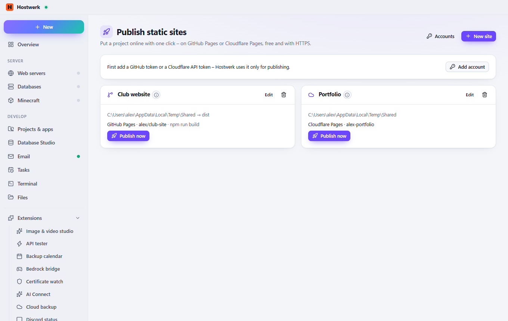

# Publish static sites

Put a project online with one click – on GitHub Pages or Cloudflare Pages, free and with HTTPS. With a build command (e.g. npm run build), a check of the folder and history per site.

[Deutsch](README.de.md) · An official [Hostwerk](https://github.com/Passimoritz/hostwerk-public) extension (SDK 2.7, native extension)



## What it does

- GitHub Pages without a local git: upload through GitHub's API into the branch gh-pages, Pages switched on, repository created on request
- Cloudflare Pages through Cloudflare's own tool (wrangler)
- Optional build command before every publish, with log
- Checks before uploading: index.html present, no .git, node_modules or .env, size limits
- Tokens sealed on this PC; history of the last 10 publishes per site

## Install

In Hostwerk: **Extensions → Discover** and click “Install”.

Native extensions run as part of Hostwerk (own server and interface part). That is why Hostwerk only installs them from the official catalogue (with checksum) or in developer mode.

## Data

`data/static-publish` – sites and sealed tokens. Removing the extension keeps them; published pages stay online.

## Develop

```bash
node --test tests/*.test.js          # tests
node build-native.js .               # build the interface (sdk/build-native.js from hostwerk-public)
node check.js . --strict             # same check as the catalogue (sdk/check.js)
```

Interface source in `ui/src`, server part in `server/`. Texts in the code are English, German is in `locales/de.json`.

## License

MIT
